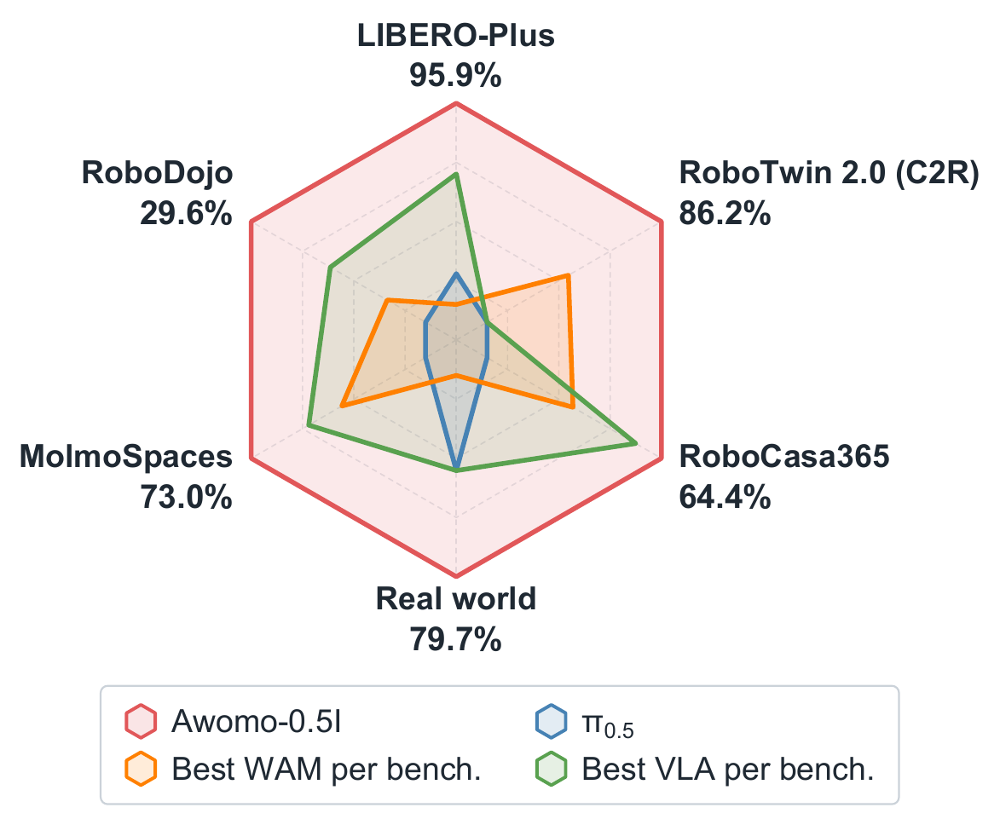
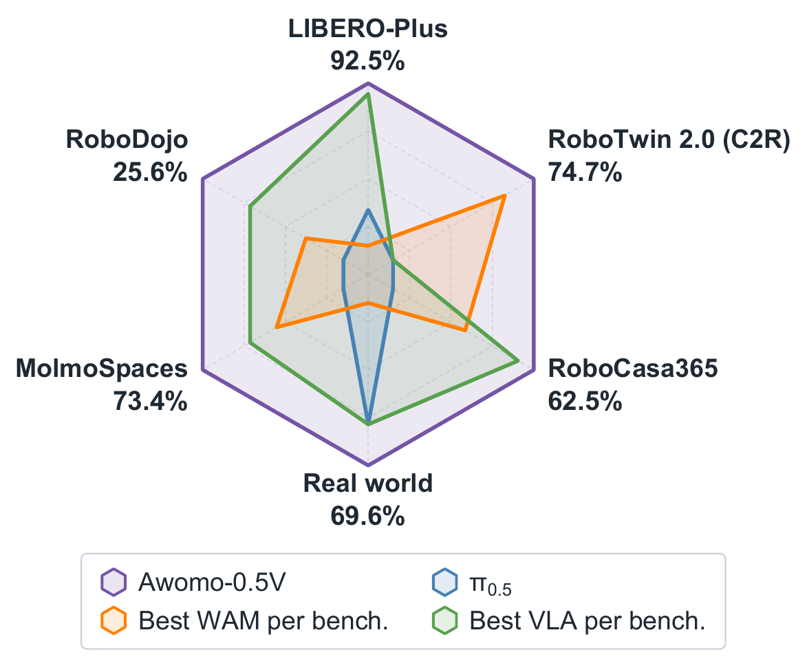

<div align="center">

<p>
  
</p>

<h1>Awomo-0.5: World Action Model Pre-trained at Scale</h1>

<p><a href="https://robocasa.ai/leaderboard.html"><b>🥇 #1 on RoboCasa365</b></a> | <a href="https://molmospaces.allen.ai/benchmark"><b>🥈 #2 on MolmoSpaces</b></a> | <a href="https://robodojo-benchmark.com/LeaderBoard"><b>🥉 #3 on RoboDojo</b></a></p>

<p>🌐 <a href="https://awomo-westlakedi.github.io/Awomo-0.5-page/"><b>Project Page</b></a> | 🤗 <a href="https://huggingface.co/Auwomo"><b>Hugging Face</b></a> | 🤖 ModelScope: <b>TBD</b> | 📄 <a href="Awomo_0_5.pdf"><b>Paper</b></a> | 🖥️ Demo: <b>TBD</b></p>

<p><a href="#introduction">Introduction</a> | <a href="#checkpoints">Checkpoints</a> | <a href="#documentation">Documentation</a> | <a href="#citation">Citation</a></p>

</div>

## 📖 Introduction

Awomo-0.5 is a codebase for training, evaluating, and running embodied policies in simulation. It provides two architecture variants with a shared action interface:

- **Awomo-0.5I** (Awomo-0.5-Image) processes image observations.
- **Awomo-0.5V** (Awomo-0.5-Video) processes video observations and temporal context.

The release targets five embodied simulation benchmarks: LIBERO Plus, MolmoSpaces, RoboTwin 2.0, RoboDojo, and RoboCasa.This release contains Awomo-0.5I/0.5V inference, RoboCasa365 evaluation, and RoboDojo SFT. Other benchmark integrations will be released progressively.

## ✨ Highlights

- 2 architecture variants under one training and evaluation interface (RoboDojo SFT released, others coming).
- 5 benchmark adapters for embodied simulation evaluation (RoboCasa365/RoboDojo released, others coming).
- 14 planned model releases.

## 🔔 News

- 🔥 **2026.10.20**: Add [RoboDojo SFT](training/robodojo/README.md) training code and XPolicyLab inference support.
- **2026.10.09**: Add [RoboCasa365 evaluation](eval_robocasa365/README.md) for Awomo-0.5I and Awomo-0.5V.
- **2026.10.03**: Release RoboDojo checkpoint and evaluation code.

## 📦 Checkpoints

<div align="center">
<table>
<tr><th rowspan="2">Benchmark</th><th colspan="3">Awomo-0.5I</th><th colspan="3">Awomo-0.5V</th></tr>
<tr><th>Result</th><th>Rank</th><th>Weights</th><th>Result</th><th>Rank</th><th>Weights</th></tr>
<tr><td>Base</td><td align="center"></td><td align="center"></td><td align="center"><a href="https://huggingface.co/Auwomo/Awomo-0.5I-base">Hugging Face</a></td><td align="center"></td><td align="center"></td><td align="center"></td></tr>
<tr><td>LIBERO Plus</td><td align="center">95.9%</td><td align="center"></td><td align="center"></td><td align="center">92.5%</td><td align="center"></td><td align="center"></td></tr>
<tr><td>MolmoSpaces</td><td align="center">73.0%</td><td align="center"><a href="https://molmospaces.allen.ai/benchmark">#3</a></td><td align="center"></td><td align="center">73.4%</td><td align="center"><a href="https://molmospaces.allen.ai/benchmark">#2</a></td><td align="center"></td></tr>
<tr><td>RoboCasa365</td><td align="center">64.4%</td><td align="center"><a href="https://robocasa.ai/leaderboard.html">#1</a></td><td align="center"><a href="https://huggingface.co/Auwomo/Awomo-0.5I-RoboCasa365">Hugging Face</a></td><td align="center">62.5%</td><td align="center"><a href="https://robocasa.ai/leaderboard.html">#3</a></td><td align="center"><a href="https://huggingface.co/Auwomo/Awomo-0.5V-RoboCasa365">Hugging Face</a></td></tr>
<tr><td>RoboDojo (score / SR)</td><td align="center">35.3 / 29.6%</td><td align="center"><a href="https://robodojo-benchmark.com/LeaderBoard">#3</a></td><td align="center"></td><td align="center">32.4 / 25.6%</td><td align="center"></td><td align="center"></td></tr>
<tr><td>RoboTwin 2.0 Full</td><td align="center">96.1%</td><td align="center"></td><td align="center"></td><td align="center">92.2%</td><td align="center"></td><td align="center"></td></tr>
<tr><td>RoboTwin 2.0 Clean-2-Random</td><td align="center">86.2%</td><td align="center"></td><td align="center"></td><td align="center">74.7%</td><td align="center"></td><td align="center"></td></tr>
</table>
</div>

<p align="center">
  
  
</p>

## 📚 Documentation

- [Deployment](docs/DEPLOYMENT.md): policy server environment and startup.
- [RoboDojo SFT](training/robodojo/README.md): data index preparation, supplied normalization parameters and training configuration.
- [RoboDojo inference in XPolicyLab](https://github.com/XPolicyLab/XPolicyLab/tree/main/policy/Awomo05): benchmark observation/action adaptation and evaluation entrypoints. Use the adapter version matching the checkpoint format.
- [RoboCasa365 evaluation](eval_robocasa365/README.md): evaluation-only, added on 2026-10-09; the RoboDojo SFT update does not change its entrypoints.

## 📜 License

The code in this repository is released under the [Apache License 2.0](LICENSE). The model weights on
[Hugging Face](https://huggingface.co/Auwomo) are released under CC BY-NC 4.0 (see the `LICENSE.md` of each checkpoint).
Base models downloaded by the code (Qwen3-VL-4B-Instruct, FLUX.2-klein-base-4B, Wan2.2-TI2V-5B) remain under their
own licenses.

## 🤝 Acknowledgements

Parts of this repository are adapted from [PatchWAM](https://github.com/TianhengW/PatchWAM).

## 📝 Citation

```bibtex
@article{team2026awomo,
  title={Awomo-0.5 Technical Report},
  author={Team, Awomo-WAM},
  year={2026}
}

@article{wang2026action,
  title={An Action Is Worth One Patch: Unified World-Action Modeling with PatchWAM},
  author={Wang, Tianheng and Xie, Zhou and Jia, Heng and Xu, Jianhua and Zhang, Tong and Yu, Kaicheng},
  journal={arXiv preprint arXiv:2609.25961},
  year={2026}
}
```
